

  

  
  
  

  



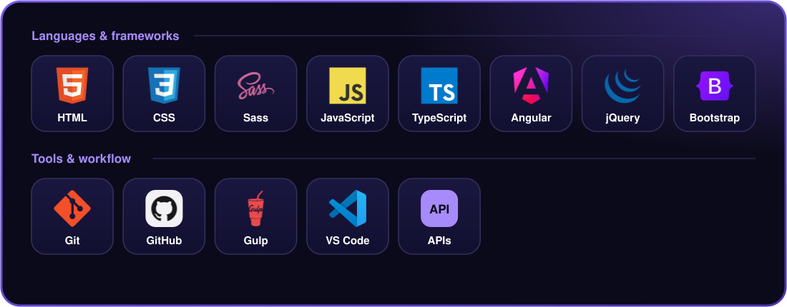


<table>

<tr>
  <td width="50%" align="center" valign="top">
    
<a href="https://asmaa930.github.io/L10N_House/">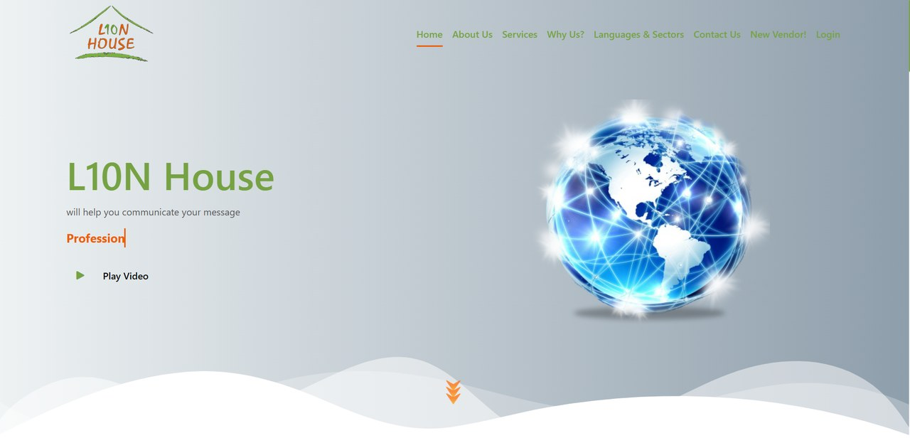</a>

    
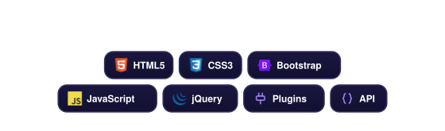

    
<a href="https://github.com/asmaa930/L10N_House">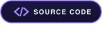</a>&nbsp;&nbsp;&nbsp;

  </td>
   <td width="50%" align="center" valign="top">
    
<a href="https://github.com/asmaa930/NewsWave">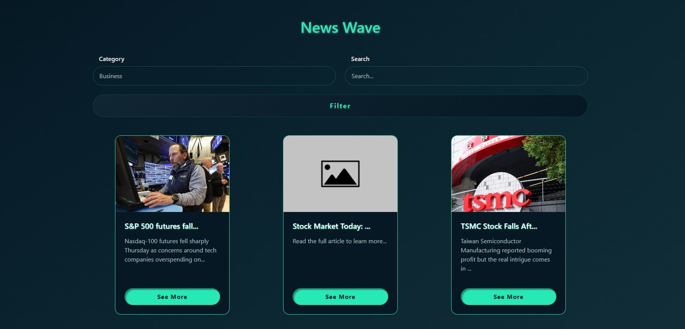</a>

    
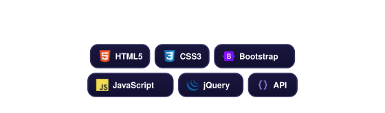

    

  </td>
</tr>
<tr>
  <td width="50%" align="center" valign="top">
    
<a href="https://asmaa930.github.io/Delici_Restaurant/">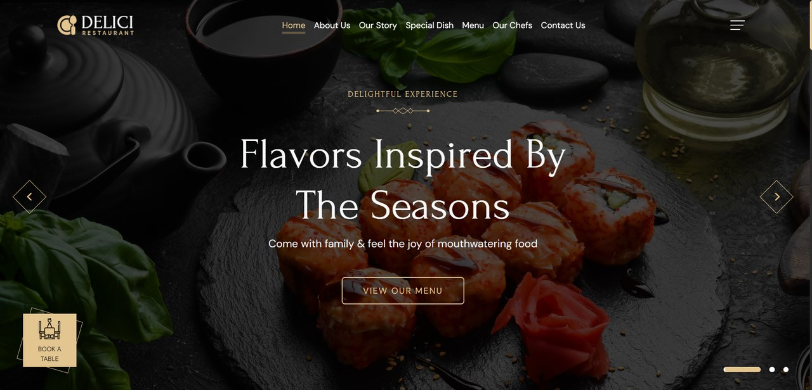</a>

    
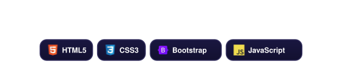

    
&nbsp;&nbsp;&nbsp;

  </td>
  <td width="50%" align="center" valign="top">
    
<a href="https://asmaa930.github.io/Nike_Shoes_Store/">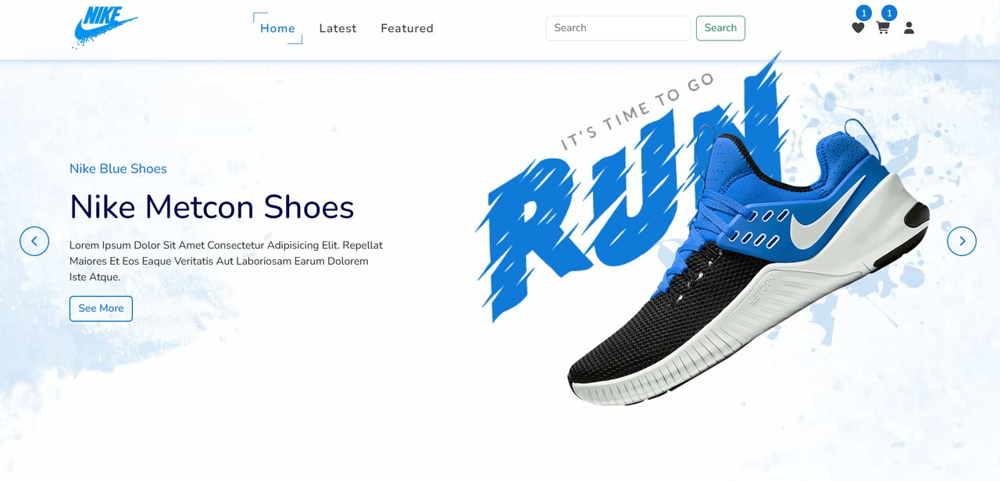</a>

    
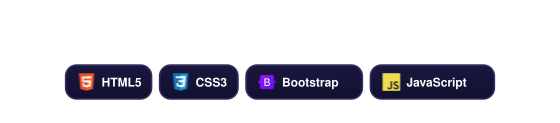

    
&nbsp;&nbsp;&nbsp;

  </td>
</tr>
  <tr>
  <td width="50%" align="center" valign="top">
    
<a href="https://asmaa930.github.io/JS_Exercise_1/">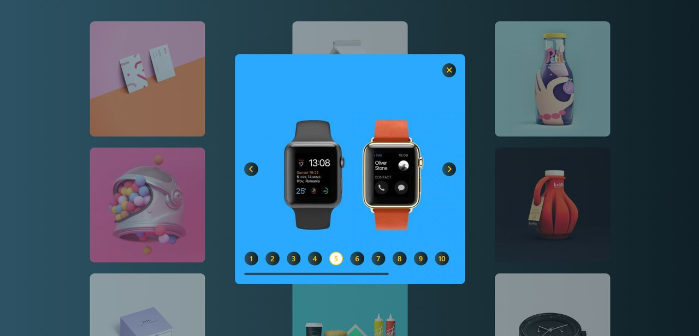</a>

    
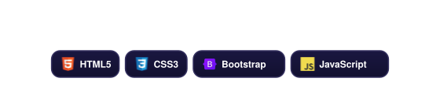

    
&nbsp;&nbsp;&nbsp;

  </td>
  <td width="50%" align="center" valign="top">
    
<a href="https://asmaa930.github.io/JS_Exercise_2/">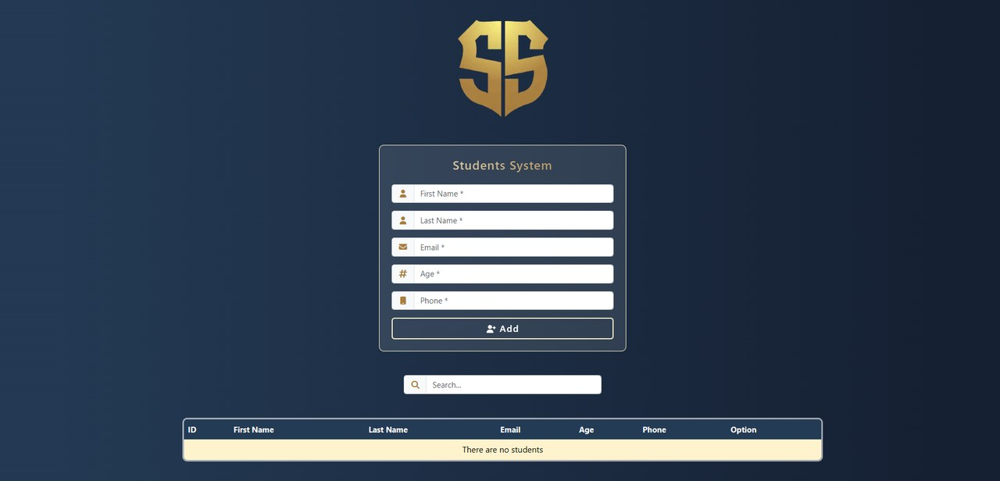</a>

    
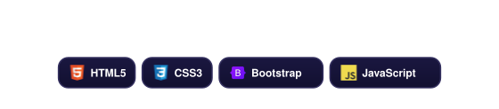

    
&nbsp;&nbsp;&nbsp;

  </td>
</tr>
  <tr>
  <td width="50%" align="center" valign="top">
    
<a href="https://asmaa930.github.io/Dine_Out/">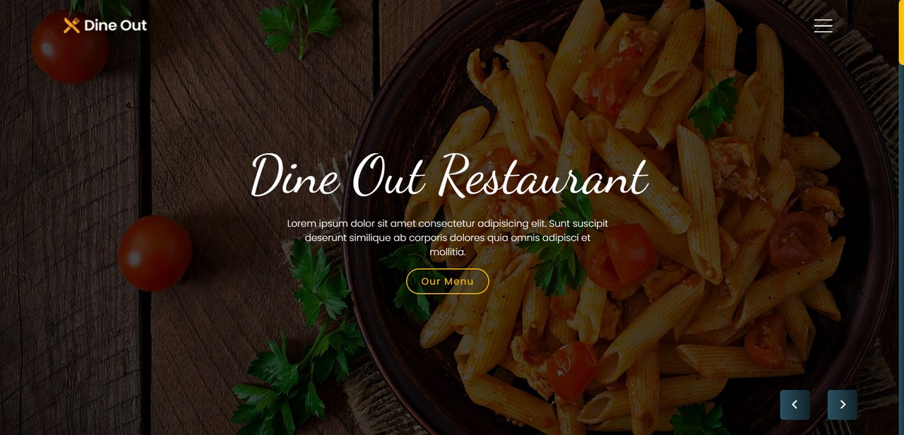</a>

    

    
&nbsp;&nbsp;&nbsp;

  </td>
  <td width="50%" align="center" valign="top">
    
<a href="https://asmaa930.github.io/Kaffa/">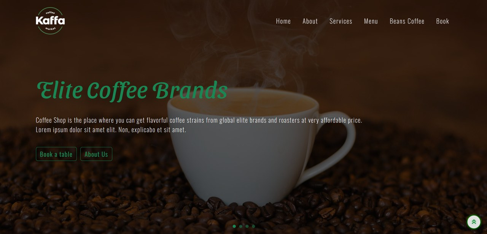</a>

    

    
&nbsp;&nbsp;&nbsp;

  </td>
</tr>

  <tr>

  <td width="50%" align="center" valign="top">
    
<a href="https://asmaa930.github.io/Gym/">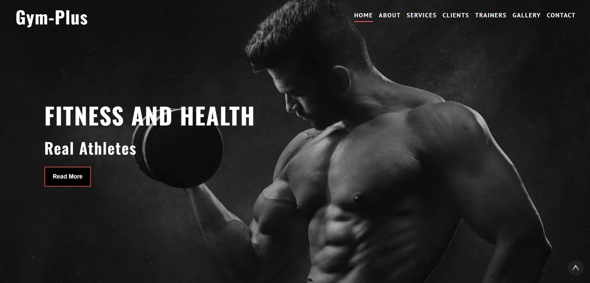</a>

    

    
&nbsp;&nbsp;&nbsp;

  </td>
     <td width="50%" align="center" valign="top">
    
<a href="https://asmaa930.github.io/Gym_Plus/">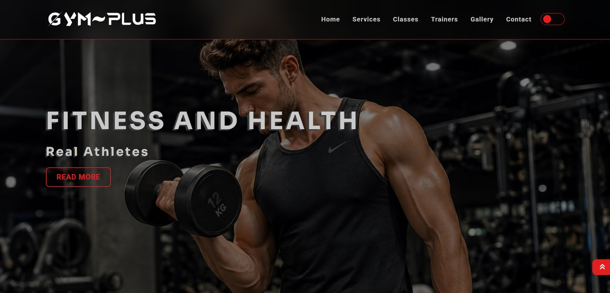</a>

    

    
&nbsp;&nbsp;&nbsp;

  </td>
</tr>
<tr>
  <td width="50%" align="center" valign="top">
    
<a href="https://asmaa930.github.io/Burger/">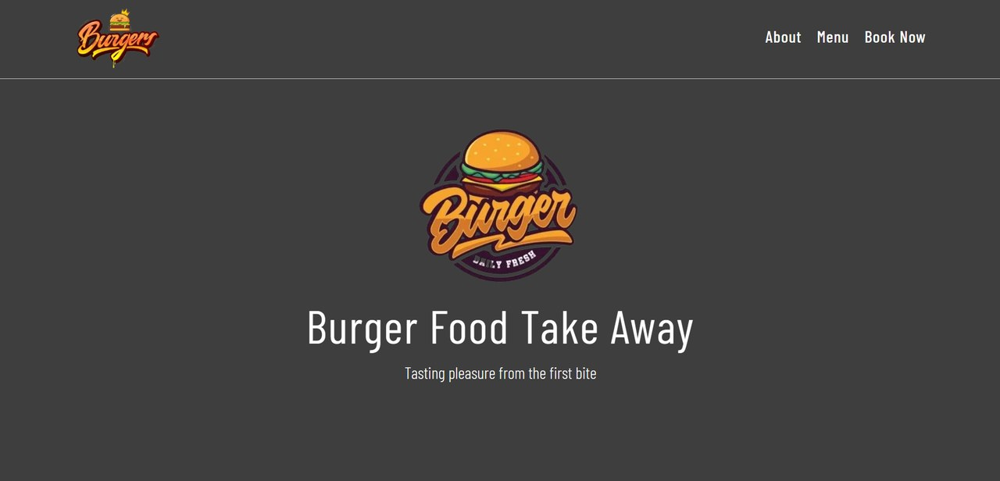</a>

    

    
&nbsp;&nbsp;&nbsp;

  </td>
  <td width="50%" align="center" valign="top">
    
<a href="https://asmaa930.github.io/Fokir/">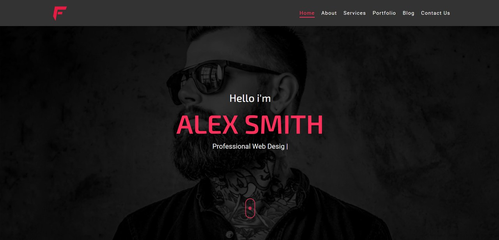</a>

    

    
&nbsp;&nbsp;&nbsp;

  </td>
</tr>

</table>

<!-- Currently learning: add assets/learning.svg then uncomment these two lines


-->


  
  

  


